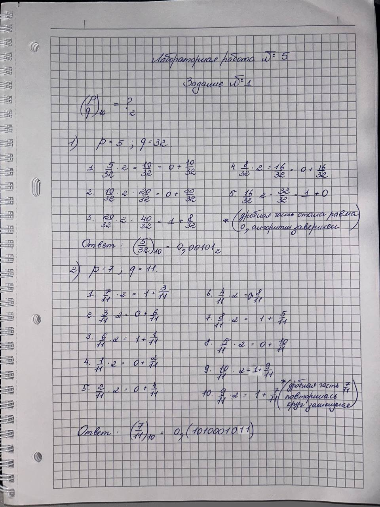
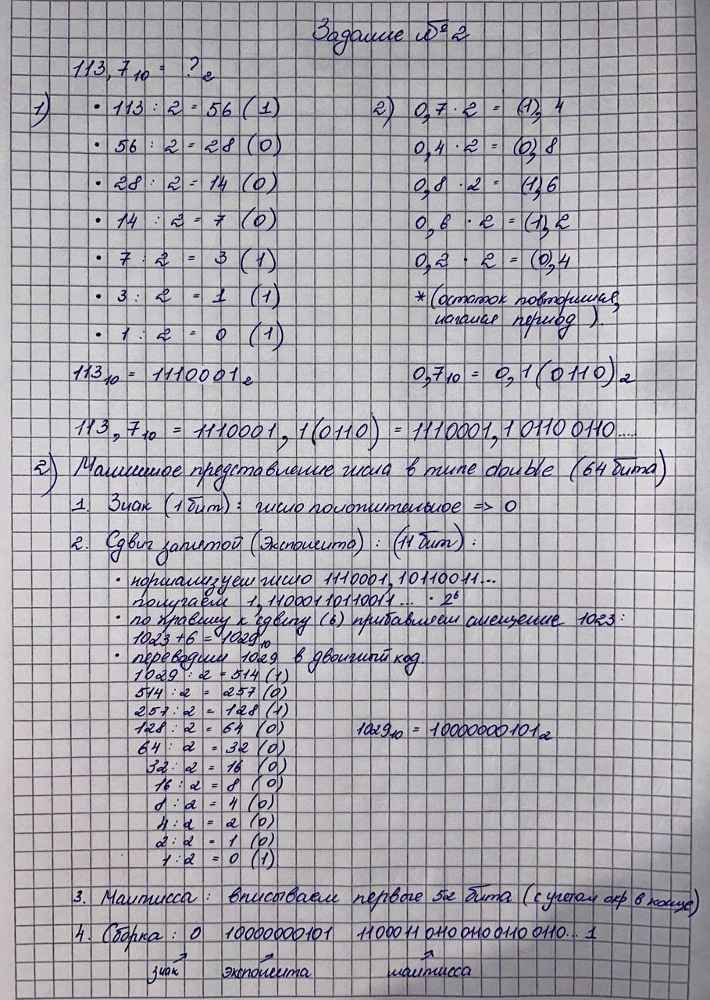
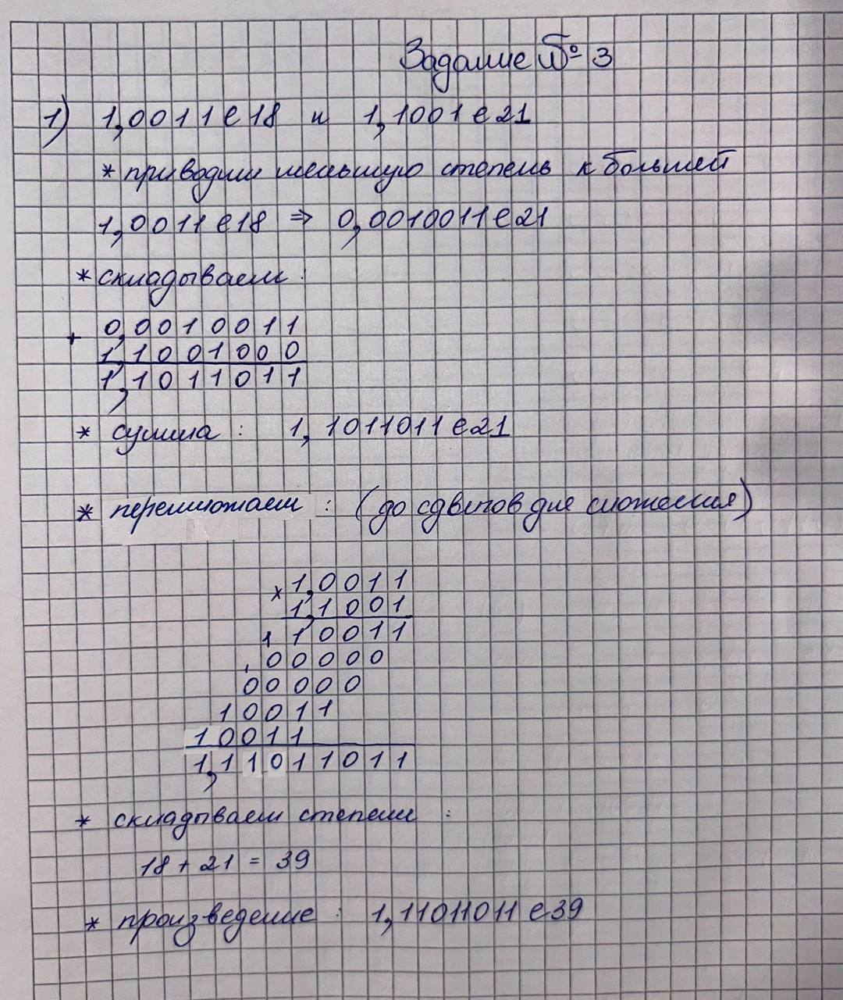
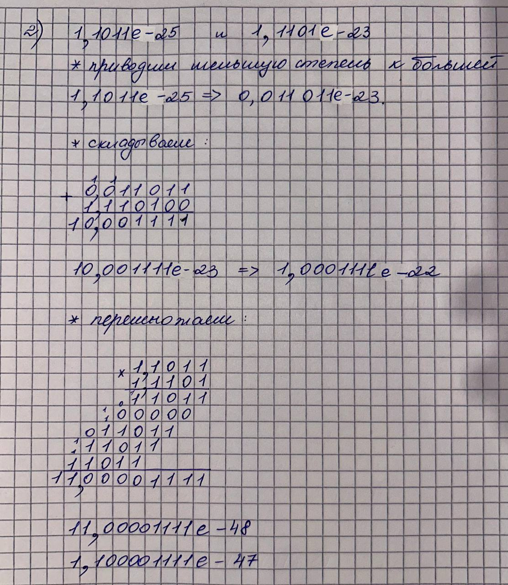
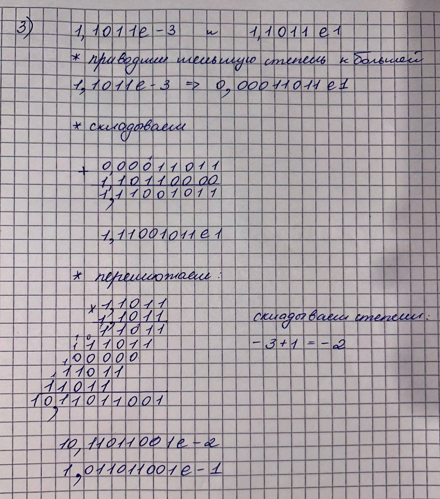
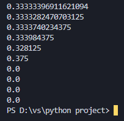

# Языки программирования
## Лабораторная работа 5

### Задание 1 **(2)**
*Переведите в двоичную запись два произвольных рациональных числа (числа вида* $\frac{p}{q}$).
*У одного из чисел знаменатель должен быть степенью двойки (32), а у другого --- некоторым числом
от 9 до 12.*

*Запись второго числа будет содержать период. Его надо найти. При решении задачи нельзя 
использовать вычислительную технику. Процесс решения должен быть представлен в отчете.*



---

### Задание 2 **(3)**
*Переведите в двоичную запись и найдите машинное представление в типе* **double**
*для произвольного вещественного числа большего, чем 100 с одним знаком после точки, например
для* $113.7$. *Цифра после точки не должна быть нулем или пятеркой.*

*При решении задачи нельзя 
использовать вычислительную технику. Процесс решения должен быть представлен в отчете.*



---

### Задание 3 **(3)**
*Найдите сумму и произведение для записанных далее пар чисел. Числа заданы в двоичной записи 
в экспоненциальном виде. Ответ необходимо записать в нормализованном экспоненциальном виде.*

* 1.0011e18 и 1.1001e21;
* 1.1011e-25 и 1.1101e-23;
* 1.1011e-3 и 1.1011e1.

*При решении задачи нельзя 
использовать вычислительную технику. Процесс решения должен быть представлен в отчете.*








---

### Задание 4 **(2)**

*Рассмотрим следующий пример в IDLE Python*
```
x = 99.99
int(x/10+0.001)
9
```

*Результат должен был быть равен 10, однако оказался другим. Почему так произошло?
Как исправить программу, чтобы она корректно переводила вещественные числа в целые?*

**Почему так происходит.**
Число 99.99 в двоичной системе не имеет точного представления. Оно хранится как 99.989999999999994884092302527...
Считаем: `99.99 / 10 = 9.998999999...`.
Прибавляем 0.001: `9.999999999...` (чуть меньше 10).
`int(...)` отбрасывает дробную часть, получается 9, а не 10.

**Как исправить.**
Использовать `round()` для округления до ближайшего целого:
`int(round(x/10 + 0.001))`.

**Ответ: причина — погрешность представления вещественных чисел в памяти. Исправление: использовать `round()`.**

---

### Задание 5 **(2)**

*Рассмотрите следующую программу. Объясните результаты ее работы. В частности,
как величина* $y$ *повлияла на ответ?*
```
x = 1/3
y = 1
for i in range(20):
print((x+y)-y)
y*=10
```

*В отчете требуется привести вычисления для оценки погрешности.*

**Что происходит.**
`x = 1/3 = 0.3333333333333333...` (в памяти хранится приближённо).
`y` сначала 1, потом 10, 100, 1000 и так далее.

В каждом шаге вычисляется `(x + y) - y`.
Если бы вычисления были точными, всегда получалось бы `x = 0.3333...`.
Но из-за ограниченной точности double при больших `y` слагаемое `x` «теряется» — оно слишком мало по сравнению с `y`.

Например, при `y = 10^16`: `x + y = 10000000000000000.333...`, но double хранит только 15–16 знаков, поэтому дробная часть теряется. Результат `(x+y)-y = 0`.

**Ответ: при больших y результат становится 0 из-за потери точности. Погрешность растёт с увеличением y.**



---

### Задание 6 **(2)**

*Для какого минимального значения* $n$ *программа на С++ выведет* **inf**? *Объясните
ответ.* *Что произойдет, если тип* **double** *заменить на* **long double**?
```
int n=...;
double s = pow(2, n);
std::cout << std::fixed << s << std::endl;
```

**Для double:**
Максимальное значение double ≈ 1.8 * 10^308.
`2^n > 1.8 * 10^308` при `n > 1023`.
Значит, `n = 1024` — минимальное, при котором выведется `inf`.

**Для long double:**
Максимальное значение long double ≈ 1.1 * 10^4932.
`n = 16384` — минимальное для `inf`.

**Ответ: для double n = 1024; для long double n = 16384.**

---

### Задание 7 **(2)**

*Допишите что-либо вместо многоточия программе на С++, чтобы программа при запуске выдавала ответ* **yes**.

```
double s = ...;
if (s != s)
std::cout << "yes";
```

**Что нужно вписать:** любое значение, которое не равно самому себе. Это `NaN` (Not a Number).

Пример: `double s = 0.0/0.0;`

---

### Задание 8 **(2)**

*Какое минимальное натуральное число при преобразовании в тип* **double** *записывается с погрешностью? Объясните
ответ. Почему следующее за ним число уже выводится без погрешности?*

**Ответ: 2^53 + 1 = 9007199254740993.**

В типе double мантисса — 52 бита, плюс неявная единица = 53 бита точности. Все целые числа до 2^53 = 9007199254740992 представляются точно.
Число 2^53 + 1 = 9007199254740993 не имеет точного представления: оно округляется до 2^53 (9007199254740992).
Следующее число 2^53 + 2 = 9007199254740994 — чётное, оно делится на 2, и его можно представить точно (как 2 * (2^52 + 1)).

**Ответ: минимальное — 2^53 + 1. Следующее (2^53 + 2) представляется точно, потому что оно чётное.**

---

### Задание 9 **(2)**

*Напишите программу для решения следующей задачи. Даны четыре рациональных числа. Напишите программу, которая сравнит сумму двух первых чисел с суммой двух последних чисел. Программа должна выводить 1, 0 или -1 в зависимости от результатов сравнения.*


