# Языки программирования
## Лабораторная работа 6

### Задание 1 **(3)**

*Рассмотрим следующую программу на С++.*

```cpp
#include <iostream>
#include <cmath>
int main() {
   double x = 0;
   const auto Pi = std::acos(0) * 2;
   std::cout << Pi << std::endl;
   return 0;
}
```

*Проверьте четыре способа объявления* **Pi**.

#### Способ 1. `const auto Pi = acos(0) * 2;`

```cpp
#include <iostream>
#include <cmath>
int main() {
   double x = 0;
   const auto Pi = acos(0) * 2;
   std::cout << Pi << std::endl;
   return 0;
}
```

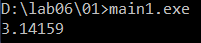

Программа компилируется и выводит `3.14159`. Функция `acos` вызывается без `std::`, так как `<cmath>` объявляет её также в глобальном пространстве имён (из языка C).

#### Способ 2. `constexpr auto Pi = std::acos(0) * 2;`

```cpp
#include <iostream>
#include <cmath>
int main() {
   double x = 0;
   constexpr auto Pi = std::acos(0) * 2;
   std::cout << Pi << std::endl;
   return 0;
}
```

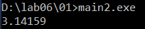

Компилятор `g++` компилирует программу и выводит `3.14159`. Это происходит потому, что `g++` считает математические функции встроенными (builtin) и умеет вычислять их на этапе компиляции. По стандарту C++17/C++20 функция `std::acos` не является `constexpr`, поэтому другие компиляторы (например, `clang++` или MSVC) выдают ошибку.


#### Способ 3. `const auto Pi = acos(x) * 2;`

```cpp
#include <iostream>
#include <cmath>
int main() {
   double x = 0;
   const auto Pi = acos(x) * 2;
   std::cout << Pi << std::endl;
   return 0;
}
```

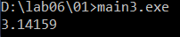

Программа компилируется и выводит `3.14159`. Значение `Pi` вычисляется во время выполнения программы, так как `x` - обычная переменная. После инициализации `Pi` изменить нельзя.

#### Способ 4. `constexpr auto Pi = std::acos(x) * 2;`

```cpp
#include <iostream>
#include <cmath>
int main() {
   double x = 0;
   constexpr auto Pi = std::acos(x) * 2;
   std::cout << Pi << std::endl;
   return 0;
}
```

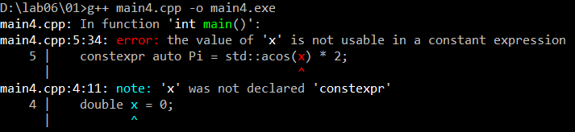

Программа не компилируется:

`error: the value of 'x' is not usable in a constant expression`

Переменная `x` не является константой, её значение известно только во время выполнения, поэтому `constexpr`-переменную нельзя ею инициализировать.

*Что можно сказать об этих вариантах? Проверьте, в каких вариантах объявляется константа этапа трансляции.*

* `const` означает только то, что значение нельзя изменить после инициализации. Само значение может вычисляться как при компиляции, так и при выполнении программы.
* `constexpr` требует, чтобы значение было вычислено на этапе компиляции. Если это невозможно, компилятор выдаёт ошибку.

В первом способе программа компилируется, но `Pi` является константой времени выполнения: её значение нельзя изменить, однако вычисляется оно при запуске программы.

Во втором способе `g++` компилирует программу и вычисляет `Pi` на этапе компиляции, то есть это константа этапа трансляции. По стандарту языка такая запись не допускается, поэтому в других компиляторах будет ошибка.

В третьем способе программа компилируется, но `Pi` - обычная константа, значение которой вычисляется во время выполнения, так как зависит от переменной `x`.

В четвёртом способе программа не компилируется, так как `x` не является константным выражением.

Таким образом, константа этапа трансляции объявляется только во втором способе.

### Задание 2 **(2)**

*Проверьте работу следующей программы на С++*

```cpp
#include <iostream>
int main() {
   {
      int x, y;
      std::cin >> x >> y;
      std::cout << x+y << std::endl;
   }
   {
      double x, y;
      std::cin >> x >> y;
      std::cout << x+y << std::endl;
   }
   return 0;
}
```

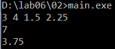

При вводе `3 4 1.5 2.25` программа выводит `7` и `3.75`.

*Нужны ли в этой программе вложенные фигурные скобки? Дайте подробный ответ с объяснением причин.*

Да, вложенные фигурные скобки нужны. Каждая пара фигурных скобок образует отдельный блок, то есть отдельную область видимости. Переменные, объявленные внутри блока, существуют только до закрывающей скобки этого блока.

В первом блоке объявлены переменные `x` и `y` типа `int`. После выхода из блока они уничтожаются, и их имена освобождаются. Поэтому во втором блоке можно снова объявить переменные с теми же именами `x` и `y`, но уже типа `double`.

Если убрать вложенные скобки, то все объявления окажутся в одной области видимости функции `main`, и компилятор выдаст ошибку повторного объявления:

`error: conflicting declaration 'double x'`

В одной области видимости нельзя объявить две переменные с одинаковым именем. Без вложенных блоков пришлось бы давать переменным разные имена.

### Задание 3 **(2)**

*Проверьте работу следующего фрагмента программы на С++.*

```cpp
#include <iostream>
int main() {
   int s = 0;
   for (int i = 0; i < 4; i++) {
      for (int i = 0; i < 3; i++) {
         s += i;
      }
      s += i;
   }
   std::cout << s << std::endl;
   return 0;
}
```

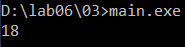

*В результате каких вычислений был получен ответ? Дайте подробный ответ.*

В программе есть две разные переменные с именем `i`. Внутренний цикл объявляет свою переменную `i`, которая скрывает (перекрывает) переменную внешнего цикла. Внутренняя `i` существует только внутри внутреннего цикла.

Поэтому:

* `s += i` внутри внутреннего цикла использует внутреннюю `i` (значения `0, 1, 2`);
* `s += i` после внутреннего цикла использует внешнюю `i` (значения `0, 1, 2, 3`).

Вычисления по итерациям внешнего цикла:

`i = 0: s = 0 + (0 + 1 + 2) + 0 = 3`

`i = 1: s = 3 + (0 + 1 + 2) + 1 = 7`

`i = 2: s = 7 + (0 + 1 + 2) + 2 = 12`

`i = 3: s = 12 + (0 + 1 + 2) + 3 = 18`

Итого:

`4 * (0 + 1 + 2) + (0 + 1 + 2 + 3) = 12 + 6 = 18`

**Ответ:** `18`.

### Задание 4 **(2)**

*Проверьте работу следующего фрагмента программы на* **Python**.

```python
s = 0
for i in range(4):
   for i in range(3):
      s += i
   s += i
print(s)
```

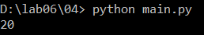

*В результате каких вычислений был получен ответ? Дайте подробный ответ.*

В Python циклы не создают собственную область видимости. Поэтому в программе существует только одна переменная `i`. Внутренний цикл не создаёт новую переменную, а перезаписывает ту же самую `i`.

После завершения внутреннего цикла в `i` остаётся последнее значение `2`. Поэтому `s += i` после внутреннего цикла всегда прибавляет `2`, а не номер итерации внешнего цикла. На следующей итерации внешний цикл просто берёт следующее значение из `range(4)` и снова записывает его в `i`.

Вычисления по итерациям внешнего цикла:

`1-я итерация: s = 0 + (0 + 1 + 2) + 2 = 5`

`2-я итерация: s = 5 + (0 + 1 + 2) + 2 = 10`

`3-я итерация: s = 10 + (0 + 1 + 2) + 2 = 15`

`4-я итерация: s = 15 + (0 + 1 + 2) + 2 = 20`

Итого:

`4 * (0 + 1 + 2) + 4 * 2 = 12 + 8 = 20`

**Ответ:** `20`.

*На основе этих примеров поясните различия между* **С++** и **Python** *при работе с переменными*.

* В **C++** переменная создаётся явным объявлением с указанием типа (`int i`). Каждый блок `{ }` и заголовок цикла `for` создают свою область видимости. Переменная с тем же именем во вложенном блоке - это новая переменная, скрывающая внешнюю. После выхода из блока она уничтожается.
* В **Python** переменная создаётся при первом присваивании, отдельного объявления нет. Блоки циклов и условий не создают новую область видимости (она создаётся только функциями, классами и модулями). Повторное использование имени означает работу с той же самой переменной. Переменная цикла продолжает существовать и после окончания цикла, сохраняя последнее значение.

Поэтому одинаковые на вид программы дают разные результаты: `18` в C++ и `20` в Python.

### Задание 5 **(2)**

*Напишите свой пример программы на* **С++**, *создающий и использующий пространства имен. Программа должна содержать не менее двух пространств имен.*

```cpp
#include <iostream>

namespace first {
    int x = 10;

    void print() {
        std::cout << "first: " << x << std::endl;
    }
}

namespace second {
    int x = 20;

    void print() {
        std::cout << "second: " << x << std::endl;
    }
}

int main() {
    first::print();
    second::print();
    std::cout << first::x + second::x << std::endl;
    return 0;
}
```

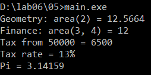

*В программе объявлены два пространства имён* `first` *и* `second`. *В каждом из них есть переменная* `x` *и функция* `print` *с одинаковыми именами, но конфликта нет, так как они находятся в разных пространствах имён.*

Обращение к переменным и функциям из пространства имён выполняется через оператор `::`:

* `first::print()` - вызывает функцию `print` из пространства `first` и выводит `first: 10`;
* `second::print()` - вызывает функцию `print` из пространства `second` и выводит `second: 20`;
* `first::x + second::x` - складывает переменные `x` из двух пространств: `10 + 20 = 30`.

Внутри функции `print` переменная `x` пишется без `first::` или `second::`, так как функция находится в том же пространстве имён, что и переменная.

### Задание 6 **(2)**

*Рассмотрим следующий фрагмент программы. Эта программа 1000000 раз обменивает значения двух длинных строк с использованием третьей строки. Проверьте, насколько быстро она работает.*

```cpp
#include <iostream>
#include <string>
#include <chrono>
int main() {
   auto start = std::chrono::steady_clock::now();

   std::string a(100000, 'a');
   std::string b(100000, 'b');
   for (int i=0;i<1000000;i++) {
      std::string c(a);
      a = b;
      b = c;
   }
   std::cout << a[0] << b[0] << std::endl;

   auto end = std::chrono::steady_clock::now();
   std::cout << "Time: "
             << std::chrono::duration<double>(end - start).count()
             << " s" << std::endl;
   return 0;
}
```

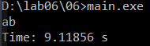

Программа работает около `9` секунд (`9.11856 s`).

*Попробуйте использовать для обмена значений строк функцию* **swap**.

```cpp
#include <iostream>
#include <string>
#include <chrono>
int main() {
   auto start = std::chrono::steady_clock::now();

   std::string a(100000, 'a');
   std::string b(100000, 'b');
   for (int i=0;i<1000000;i++) {
      std::swap(a, b);
   }
   std::cout << a[0] << b[0] << std::endl;

   auto end = std::chrono::steady_clock::now();
   std::cout << "Time: "
             << std::chrono::duration<double>(end - start).count()
             << " s" << std::endl;
   return 0;
}
```

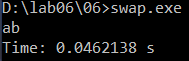

*Проверьте, изменилось ли время работы. В чем ошибка исходной программы?*

Время работы уменьшилось примерно в `200` раз: с `9.11856` до `0.0462138` секунды. Функция `swap` не копирует символы строк, а только обменивает их внутренние указатели на данные, длину и ёмкость.

Ошибка исходной программы в том, что на каждой итерации выполняется три полных копирования строки длиной `100000` символов:

* `std::string c(a);` - копирование `a` в `c`;
* `a = b;` - копирование `b` в `a`;
* `b = c;` - копирование `c` в `b`.

*Исправьте исходную программу, чтобы ускорить ее работу. Изменения не должны затрагивать общий вид программы (присваивания, использование временной переменной).*

```cpp
#include <iostream>
#include <string>
#include <chrono>
#include <utility>
int main() {
   auto start = std::chrono::steady_clock::now();

   std::string a(100000, 'a');
   std::string b(100000, 'b');
   for (int i=0;i<1000000;i++) {
      std::string c(std::move(a));
      a = std::move(b);
      b = std::move(c);
   }
   std::cout << a[0] << b[0] << std::endl;

   auto end = std::chrono::steady_clock::now();
   std::cout << "Time: "
             << std::chrono::duration<double>(end - start).count()
             << " s" << std::endl;
   return 0;
}
```

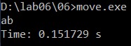

*Функция* `std::move` *позволяет вместо копирования использовать перемещение. При перемещении строка не копирует символы, а забирает указатель на данные у исходной строки. Общий вид программы сохранился (временная переменная и три присваивания), а время работы уменьшилось с* `9.11856` *до* `0.151729` *секунды (примерно в* `60` *раз), то есть стало сравнимо с вариантом, использующим* `swap`.

### Задание 7 **(2)**

*Рассмотрим программу на языке* **Python**.

```python
a = 'Hello world'
print(a, id(a))
b = a
print(b, id(b))
a += ' and goodbye'
print(a, id(a))
print(b, id(b))
```

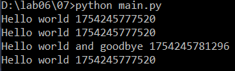

*Объясните ее работу. В какой момент создавались строки?*

В Python переменные - это имена (ссылки) на объекты, а не области памяти с самими значениями.

1. `a = 'Hello world'` - создаётся строковый объект `'Hello world'`, и имя `a` ссылается на него.
2. `b = a` - новая строка не создаётся. Имя `b` начинает ссылаться на тот же самый объект, поэтому `id(a)` и `id(b)` совпадают.
3. `a += ' and goodbye'` - строки в Python неизменяемые, поэтому изменить существующий объект нельзя. Создаётся новый строковый объект `'Hello world and goodbye'`, и имя `a` теперь ссылается на него. Поэтому `id(a)` изменился.
4. `b` по-прежнему ссылается на старый объект `'Hello world'`, поэтому значение и `id(b)` не изменились.

Таким образом, строки создавались два раза: при первом присваивании `a = 'Hello world'` и при выполнении `a += ' and goodbye'` (также создаётся объект для литерала `' and goodbye'`).

*Что означает значение, возвращенное функцией* **id**?

Функция `id` возвращает уникальный идентификатор объекта, который не меняется в течение всего времени жизни объекта. В CPython это адрес объекта в памяти. Если у двух переменных `id` совпадает, значит они ссылаются на один и тот же объект.

### Задание 8 **(2)**

*Пусть* **a** - *строковая переменная в программе на* **Python**. *Есть ли разница между работой присваивания* `b = a` и `b = a[:]`?

*Напишите программу для демонстрации различий.*

```python
a = 'Hello world'

b = a
c = a[:]

print('a:', a, id(a))
print('b = a   :', b, id(b), b is a)
print('c = a[:]:', c, id(c), c is a)

a += '!'
print()
print('после a += "!"')
print('a:', a, id(a))
print('b:', b, id(b))
print('c:', c, id(c))

print()
print('Для сравнения - список (изменяемый тип):')
x = [1, 2, 3]
y = x
z = x[:]
print('y is x:', y is x)
print('z is x:', z is x)
x.append(4)
print('x:', x)
print('y:', y)
print('z:', z)
```

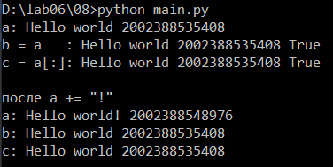

Для строк разницы нет. `b = a` делает так, что `b` ссылается на тот же объект. Срез `a[:]` по смыслу создаёт копию строки, но так как строки неизменяемые, Python не создаёт копию, а возвращает тот же самый объект. Поэтому `b is a` и `c is a` равны `True`, а `id` всех трёх переменных совпадают.

После `a += '!'` создаётся новая строка, а `b` и `c` продолжают ссылаться на старую. Изменить строку "на месте" нельзя, поэтому различие между копией и ссылкой для строк никогда не проявится.

Для сравнения в программе показан список (изменяемый тип). Для него `y = x` даёт ссылку на тот же объект, а `z = x[:]` создаёт новый список-копию. После `x.append(4)` изменение видно через `y`, но не через `z`.

### Задание 9 **(3)**

*Напишите программу на языке* **Python**, *которая создаст 2600 переменных с именами от* **a0** *до* **a99**, *от* **b0** *до* **b99** *и так далее, от* **z0** *до* **z99**. *Присвойте всем переменным различные значения от 1 до 2600.*

```python
value = 1
for letter in 'abcdefghijklmnopqrstuvwxyz':
    for number in range(100):
        globals()[letter + str(number)] = value
        value += 1

print(a0, a99)
print(b0, b99)
print(m50)
print(z0, z99)
```

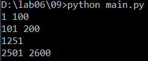

*Функция* `globals()` *возвращает словарь глобальных переменных модуля, в котором ключ - имя переменной, а значение - её значение. Добавление нового ключа в этот словарь создаёт новую глобальную переменную.*

Всего создаётся `26 * 100 = 2600` переменных. Значение переменной вычисляется как:

`номер буквы * 100 + число + 1`

Например:

`a0 = 0 * 100 + 0 + 1 = 1`

`m50 = 12 * 100 + 50 + 1 = 1251`

`z99 = 25 * 100 + 99 + 1 = 2600`
